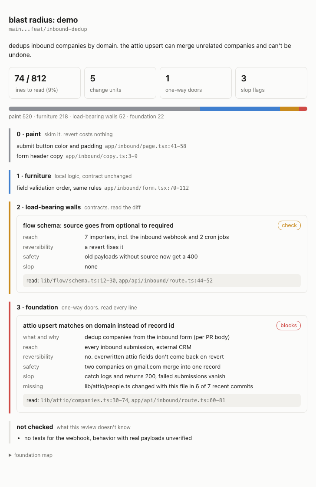

# blast-radius

a skill for claude code and codex that tells you which lines of a PR you actually have to read.

everyone's shipping code they didn't read now. i get the appeal. i also don't
want AI slop sitting in my db layer for six months before anyone notices.

so here's the compromise. not every line in a PR matters the same. a button
color and a database migration are not the same kind of change, and pretending
they are is why reviewing AI code feels exhausting. this skill sorts the diff
from "who cares" to "read every character", checks the scary parts, and gives
you a short list of `file:line` ranges. read those. skim the rest.



## the idea

think of your codebase as a building.

| tier | name | example | what you do |
|---|---|---|---|
| 0 | paint | button color, copy, docs | glance at it |
| 1 | furniture | logic inside one function, same inputs and outputs | skim it |
| 2 | load-bearing walls | exported types, API shapes, env vars, new deps | read the diff |
| 3 | foundation | migrations, DB writes, auth, payments, infra, calls to other systems | read every line |

nobody calls a structural engineer to repaint a wall. nobody lets the intern
move a load-bearing wall without one either. same thing here.

the main question for every change is **can a `git revert` undo it?** a bad
color, sure. a migration that dropped a column, or 400 records already
overwritten in your CRM, no. those are one-way doors and they get the most
attention.

## install

one command, both agents:

```bash
npx skills add jakubkrauza/blast-radius -g -a claude-code codex -y
```

no node? same result with plain git:

```bash
curl -fsSL https://raw.githubusercontent.com/jakubkrauza/blast-radius/main/install.sh | bash
```

restart your agent after either one. that's it. no config, no api keys,
nothing to set up per repo.

where it ends up:

| agent | folder |
|---|---|
| claude code | `~/.claude/skills/blast-radius` |
| codex | `~/.agents/skills/blast-radius` |

the curl script clones the repo to `~/.local/share/blast-radius` and symlinks
it into the agents it finds. it only touches folders it created.

**update:** `npx skills update blast-radius`, or run the curl line again.
**remove:** `npx skills remove blast-radius -g`, or the curl line with
`| bash -s -- --uninstall`.

**one repo for the whole team:** run the npx line inside the repo without
`-g`, then commit `.agents/skills/` and `.claude/skills/`.

you also need `git` and `bash`. `gh` only if you pass PR numbers.

## use

| | claude code | codex |
|---|---|---|
| current branch vs main | `/blast-radius` | `$blast-radius` |
| a PR (your working tree stays as is) | `/blast-radius 142` | `$blast-radius 142` |
| some other branch | `/blast-radius feat/dedup` | `$blast-radius feat/dedup` |
| also write an html page like the screenshot | add `--html` | add `--html` |
| also post the report as a PR comment | add `--comment` | add `--comment` |
| report and voiceover in another language | add `--lang pl` | add `--lang pl` |
| also make a narrated video walkthrough | add `--video` | add `--video` |

it never posts anything unless you pass `--comment`. it never runs on its own
either, only when you call it.

two codex notes:

- claude code runs the review in a fresh sub-agent automatically. in codex,
  run it in a new session (not the one that wrote the code) for an honest
  read. if it can't, the report says so at the top.
- codex's default sandbox has no network. local branches work fine. PR
  numbers (`gh`, `git fetch`) and the npm registry check need network, so
  allow it or the report lists those under "not checked".

you can also run the git part on its own, no AI involved:

```bash
bash ~/.claude/skills/blast-radius/scripts/signals.sh main HEAD
```

## video walkthroughs

add `--video` and you also get an mp4: a colleague who read the PR walks you
through it in 60 to 120 seconds. tl;dr first, then what changed in the
architecture (before and after, as a diagram), the tiers, the risky code with
the bad lines lit up, how they'd fix it, and what to read.

[watch the demo](docs/demo.mp4) (polish voiceover, 1080p)

- the agent writes a small `video.json` from the review. the scene types are
  in [video.md](skills/blast-radius/video.md), the demo's script is
  [example.pl.json](skills/blast-radius/video/example.pl.json)
- [beUI](https://beui.dev) components (file tree, diff, code block) render the
  real code, so nothing on screen is made up
- every animation waits for the word that explains it. the voice gives
  per-character timestamps, the scenes hang off those
- it renders frame by frame on a virtual clock, so no dropped frames even at
  4k60. `--quality draft|hd|4k` inside `make.mjs`, default hd
- voiceover by [ElevenLabs](https://elevenlabs.io) if you set a key, any
  language they support. no key: a silent video with captions

```bash
# once, optional. without it you get captions only
mkdir -p ~/.config/blast-radius
echo "ELEVENLABS_API_KEY=sk_..." >> ~/.config/blast-radius/env
```

optional: `ELEVENLABS_VOICE_ID` (default is the premade "Chris") and
`ELEVENLABS_MODEL` (default `eleven_v4`). free elevenlabs plans only get
premade voices over the api, and a 90 second video is about 1500 characters
of a 10k monthly free quota. lines are cached, re-renders are free.

the first `--video` run installs the player (`npm install`, ~300 MB with
chrome). needs node 20+.

## what you get

a markdown report, paint at the top, foundation at the bottom. the first line
is the number you care about:

```
## blast radius: PR #142 (main...feat/inbound-dedup)

read 74 of 812 changed lines (9%). 11 change units, 1 one-way door, 3 slop flags.

    paint       ██████████████████████████  520
    furniture   ███████████                 218
    walls       ███                          52
    foundation  █                            22
```

every tier 2 and 3 change then gets:

- what changed and whether it matches what the PR says it does
- reach: who calls it, with the callers actually opened and counted
- reversibility: does a revert fix it
- scale: queries in loops, unbounded reads, missing pagination
- safety: authz, input validation, secrets, errors that disappear
- slop flags (more below)
- what's missing: files that always change with this one but didn't
- a verdict: `ok`, `check` or `blocks`
- the exact ranges to read

and a "not checked" section at the end, because "i found nothing" and "i
didn't look" are different things.

full example in [examples/sample-report.md](examples/sample-report.md).

want proof it's not just a pretty template? i made a toy repo with five
planted problems and ran it in both agents:

- [claude code](examples/real-run-claude.md) found all five, plus a
  check-then-insert race i didn't plant on purpose
- [codex](examples/real-run-codex.md) found four. on the fifth it argued the
  new date helper isn't a duplicate because it forces UTC and the old one
  doesn't. fair, honestly

## how it works

1. **runs with fresh eyes.** in claude code the skill uses `context: fork`,
   so the reviewer never saw the conversation where the code got written. in
   codex you get that by starting a new session. it matters because models
   are bad at catching their own mistakes. one AWS study had models wave
   through 31.7% of their own behavior-changing bugs.
2. **maps the repo.** a few tool calls to find where data, auth and outside
   calls live, plus your `AGENTS.md` / `CLAUDE.md` / `CONTRIBUTING.md` rules.
   this map goes in the report so you can see when it guessed wrong.
3. **runs `signals.sh`.** plain git and grep. per file it gets a minimum tier
   from the path, approximate fan-in, churn, author count, files that usually
   change with it but aren't in the PR, new dependency lines, and added lines
   that write to a db, call the network, read secrets or swallow errors.
4. **splits the diff by intent, not by file.** one file can have a color tweak
   and a contract change. those are two units.
5. **tiers each unit.** the script's number is a floor. the model can raise a
   tier, never lower it.
6. **digs into tiers 2 and 3.** opens callers, checks reversibility, runs the
   slop checklist.

## why the model doesn't get the final say

meta ran this experiment for real. they compared a general code LLM against a
plain logistic regression at predicting which diffs cause incidents. the LLM
caught 0.58x to 0.82x as many incidents as the regression. vibes lose to
counting.

so the hard signals (paths, fan-in, writes, deps) set a floor, and the model's
job is to explain, add context, and push things up when it finds something.

## slop checks

"is this slop?" is a useless prompt. these are specific, each with a way to
prove it ([slop-checks.md](skills/blast-radius/slop-checks.md)):

- reinvented helper that already exists in the repo
- dead code: new exports, params or fields nothing uses
- swallowed errors (`catch {}`, log-and-continue, return 200 on failure)
- defensive noise: null checks on things that can't be null
- abstraction with one caller
- weakened tests: removed asserts, `.skip`, regenerated snapshots
- type escapes: `any`, `@ts-ignore`, `eslint-disable`
- made-up or sketchy dependencies (checked against the registry)
- scope creep vs the PR description
- comments that narrate the diff
- whatever your repo's own rules file says

## what it's not

- not an approval. it never says "safe to merge"
- not a bug hunter. it finds bugs on the way, but if that's what you want,
  run a real review too (`/code-review` in claude code, `/review` in codex)
- not a linter. use your linter
- doesn't run your code or your tests

## known limits

- fan-in is a text search. it misses dynamic imports and over-counts files
  with common names
- path patterns assume common folder names (`migrations/`, `auth/`, `api/`).
  weird layouts get caught by the repo map step, mostly
- only the first 80 files get the per-file stats. if your PR touches more,
  that's a finding in itself
- two runs on the same PR won't match word for word. the floors keep the
  tiers that matter stable
- a fresh agent reads your repo each time, so it costs real tokens. fine for
  PRs, silly for every commit

## make it yours

it's four markdown files and a bash script in
[`skills/blast-radius/`](skills/blast-radius). fork it and change them.

- [SKILL.md](skills/blast-radius/SKILL.md) the workflow
- [tiers.md](skills/blast-radius/tiers.md) what counts as paint vs foundation
- [slop-checks.md](skills/blast-radius/slop-checks.md) the checklist
- [report-format.md](skills/blast-radius/report-format.md) what the output looks like
- [scripts/signals.sh](skills/blast-radius/scripts/signals.sh) path patterns are at the top (`T3`, `T2`)
- [agents/openai.yaml](skills/blast-radius/agents/openai.yaml) codex settings (no auto-trigger)
- [video.md](skills/blast-radius/video.md) and [video/](skills/blast-radius/video) the video scenes, player and renderer

## stuff i read while building this

- meta's [diff risk score](https://engineering.fb.com/2025/08/06/developer-tools/diff-risk-score-drs-ai-risk-aware-software-development-meta/) and the [LLM vs regression results](https://arxiv.org/html/2410.06351v1)
- meta's [RADAR paper](https://arxiv.org/pdf/2605.30208) on auto-landing low-risk diffs
- kamei et al, [just-in-time quality assurance](https://sail.cs.queensu.ca/data/pdfs/TSE_ALarge-ScaleEmpiricalStudyOfJust-in-TimeQualityAssurance.pdf), why spread and history predict bugs better than size
- [articulate but wrong](https://arxiv.org/pdf/2605.21537), models reviewing their own code
- codescene's docs on [hotspots and change coupling](https://docs.enterprise.codescene.io/versions/6.3.3/guides/technical/hotspots.html)
- gitclear's [2025 report](https://blog.robbowley.net/2025/02/17/gitclears-latest-report-indicates-genai-is-having-a-negative-impact-on-code-quality/) on duplication in AI-era code
- the CSA note on [slopsquatting](https://labs.cloudsecurityalliance.org/research-rb/csa-research-note-slopsquatting-ai-coding-assistant-supply-c/)

## license

MIT
